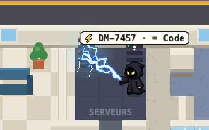
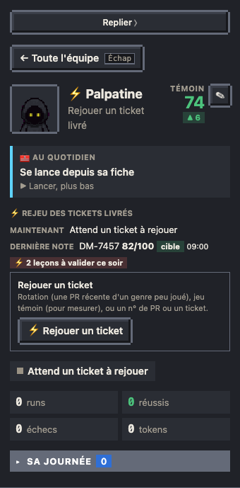

# Palpatine rejoue un ticket

Pour savoir si la chaîne d'implémentation fait du bon travail, on lui fait refaire un ticket dont on connaît déjà la bonne réponse. Le rejeu prend une PR déjà mergée, remet le dépôt au commit d'avant, laisse la chaîne refaire le ticket en essai et sans gate, puis note son travail contre la vraie PR (sur 100, cible 80). Le détail du rejeu : `docs/architecture/rejeu.md`.

Au rez-de-chaussée, c'est Palpatine qui le porte, dans la salle des serveurs.

## Le lancer

Seulement à la main, de deux endroits :

- **Sa fiche** (clic sur Palpatine) : « ⚡ Rejouer un ticket ». La carte Kronn demande le jeu (rotation : une PR récente d'un genre et d'un coin du code peu joués ; jeu témoin : les PR fixes du réglage `rejeu.temoin`, pour mesurer) et, si tu veux, un n° de PR ou une clé de ticket.
- **La fiche d'un ticket terminé** : « ⚡ Rejouer avec Palpatine », le ticket déjà rempli.

Les deux boutons sont grisés pendant un rejeu : un seul à la fois.

## Ce qu'on voit

- **Il attend** toujours dans la salle des serveurs, de face ; de temps en temps, une étincelle bleue à la main.
- **Pendant le rejeu**, il se tourne vers la baie, les lumières de la salle baissent, et par rafales il la foudroie : sa main se charge, puis les éclairs, un flash dans la salle, des arcs sur la baie, des étincelles qui rebondissent au sol, les voyants qui s'affolent ; la baie fume de chaleur entre deux rafales. Sa bulle suit l'étape du run (« ⚡ DM-2041 · ⌨ Code »). La loupe s'ouvre quand un rejeu commence.
- **À la fin**, sa bulle donne la note 5 minutes (« ⚡ DM-2041 · 82/100 · cible atteinte »), et une ligne part dans le fil.
- **En panne**, la salle passe en alarme rouge et sa bulle dit à quelle étape ; la ligne du fil est importante.

Dans « Comment lire le plan », l'onglet 🎬 Scènes a « Palpatine rejoue un ticket » (« ▶ voir »).

## Sa fiche

Elle reste courte :

- **Maintenant** : ce qu'il rejoue, depuis quand et à quelle étape, ou « Attend un ticket à rejouer ».
- **Dernière note** : le ticket, la note sur 100 et un tag « cible » (80 ou plus) ou « sous 80 ». C'est le rejeu du jour s'il y en a un, sinon le dernier relevé par la page « Rejeu · bilan ».
- **« ⚡ 2 leçons à valider ce soir »** quand la mémoire du soir attend ta validation sur des leçons tirées du rejeu (la gate du marchand de sable).
- Le bouton **« ⚡ Rejouer un ticket »**.
- En haut à droite, à côté du nom, le bloc **TÉMOIN** : la moyenne du jeu témoin (les PR fixes de `rejeu.temoin`, rejouées avec la version de la chaîne en service), et dessous son écart avec la version précédente de la chaîne : vert « ▲ 6 » si elle monte, rouge « ▼ 3 » si elle baisse, gris « = 0 » à moins d'un point. Au survol : « Moyenne du jeu témoin : 74, +6 depuis la version a1b2c3d » (une version de la chaîne est l'empreinte courte de sa configuration). Pas de bloc tant que le jeu témoin n'a pas été joué.

Le détail (parts de chaque note, historique, écarts du juge) est sur la page « Rejeu · bilan » ([40-rejeu-bilan](40-rejeu-bilan.md)). Sans elle, la fiche marche comme avant, sans le bloc TÉMOIN.

## Ce qu'il faut

Le rejeu s'installe avec la chaîne d'implémentation (modèles `rejeu` et `impl_rejeu`, `python3 tools/upgrade.py`) ; Palpatine apparaît alors seul (`team/agents.json`, `model: "rejeu"`). Un pack d'équipe peut le remplacer par son personnage, de même clé.

La note vient de la sortie de l'étape `range` du run, relue par le cron du plan : rien de plus à installer.
