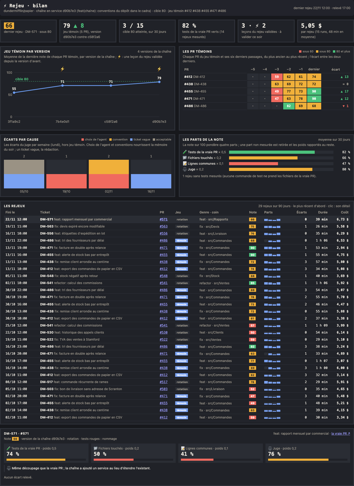

# Le bilan du rejeu

Une page Kronn à part, « Rejeu · bilan », garde l'historique des rejeux de Palpatine ([Palpatine rejoue un ticket](39-palpatine.md)) : la note de chaque rejeu contre la vraie PR, la moyenne du jeu témoin d'une version de la chaîne à l'autre, ce que le juge a relevé, les leçons du rejeu passées par la mémoire du soir et ce que coûte un rejeu. Son chiffre clé (la moyenne du jeu témoin) tient dans l'écran du vidéoprojecteur.

## L'installer et la projeter

`python3 tools/install.py` crée la page avec le rejeu (il vient avec la chaîne d'implémentation) et son cron « bilan du rejeu (1 h) ». Après une mise à jour : `git pull && python3 tools/upgrade.py` (crée la page, le cron et le dataset `rejeu_resume` de la page du Bureau s'ils manquent, puis publie). Pour la projeter : « Mes pages Kronn » sur l'écran mural, « ＋ Ajouter » la page « Rejeu · bilan », puis « 📽 Projeter en TV ».

La page se met à jour toutes les heures, en semaine aux heures du bureau.

## Ce qu'on y voit

En haut : le dépôt rejoué, la version de la chaîne en service, la cible (80), les PR du jeu témoin (`rejeu.temoin`), l'heure du dernier rejeu et celle du relevé (un relevé en erreur le dit).

- **Six chiffres** : la note du dernier rejeu (ticket, cible atteinte ou sous 80) ; la moyenne du jeu témoin et son écart avec la version précédente de la chaîne (▲ vert, ▼ rouge, = sous un point) ; la cible atteinte sur les rejeux des 30 derniers jours ; la part des tests de la vraie PR verts sur le code de la chaîne ; les leçons du rejeu validées et celles qui attendent ce soir (⚡) ; le coût moyen d'un rejeu et sa durée.
- **Jeu témoin par version** : pour chaque version de la chaîne, la moyenne de la dernière note de chaque PR témoin jouée avec elle, la cible en pointillés. Un ⚡ au-dessus d'une version : une leçon du rejeu a été validée depuis la version d'avant ; on voit si elle a aidé.
- **Les PR témoins** : chaque PR du jeu témoin et ses six derniers passages (rouge sous 60, ambre sous 80, vert à 80 et plus), et l'écart entre les deux derniers. Le survol d'une case donne sa date et sa version.
- **Écarts par cause**, par semaine : ce que le juge a relevé, rangé par cause (choix de l'agent, convention, ticket vague, acceptable), hors jeu témoin : il mesure la chaîne et n'est jamais source de leçon.
- **Les parts de la note** sur 30 jours : tests de la vraie PR (poids 0,5), fichiers touchés (0,2), lignes communes (0,1), juge (0,2), et combien de rejeux n'ont pas pu lancer les tests (aucune commande de test ne prend leurs fichiers).
- **Les rejeux**, le plus récent d'abord : fini le, ticket, PR, jeu (rotation ou témoin), genre et coin du code, la note (ou « escaladé » quand la chaîne s'est arrêtée sur une escalade), une mini barre des quatre parts (hachurée : non mesurée), les écarts comptés, durée et coût.
- **Le détail d'un rejeu** (clic sur une ligne, ou Entrée) : les quatre parts en jauges, la phrase du juge, ses écarts en pastilles avec leur cause et leur leçon, et le lien vers la vraie PR.

## D'où viennent les données

Les rejeux rangés par `rejeu.py` dans le dossier du rejeu (`rejeu.dossier`, par défaut `~/.local/share/pixel-bureau/rejeu`), et les leçons du rejeu de la mémoire du soir (`lecons.json` du même dossier ; sans lui, aucune). Le cron (sans jetons) a trois étapes, chacune relançable seule : `releve` lit dans Kronn la durée et le coût de chaque rejeu (ses postes compris ; un run fini n'est relu qu'une fois et reste en cache dans `~/.cache/pixel-bureau/rejeu_bilan/`) et regarde si les leçons à valider attendent encore à leur gate ; `bilan` publie le dataset `rejeu_bilan` de la page ; `resume` publie `rejeu_resume` dans la page du Bureau, pour la fiche de Palpatine (jeu témoin, dernier rejeu, leçons).
