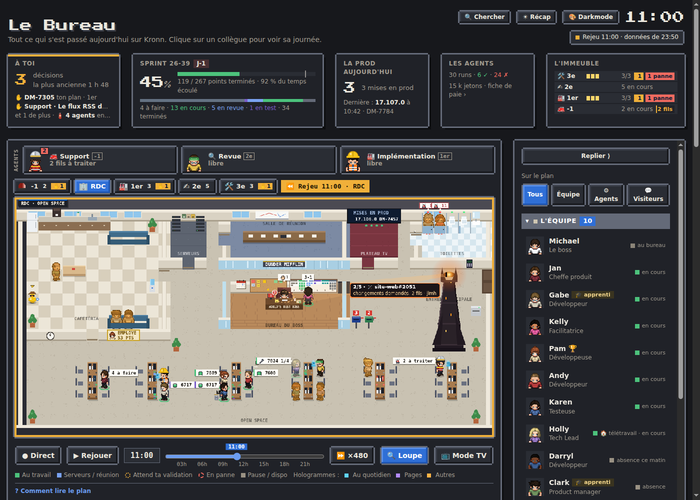
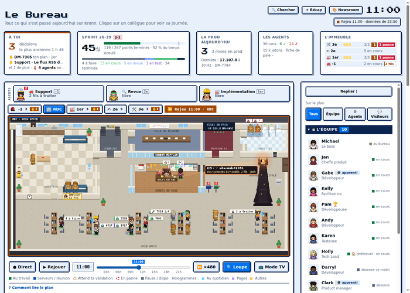
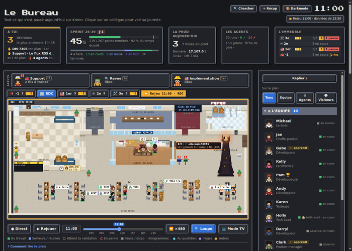
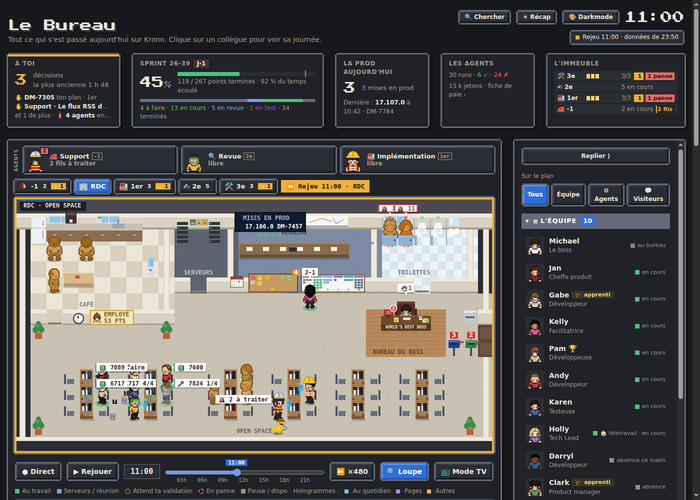
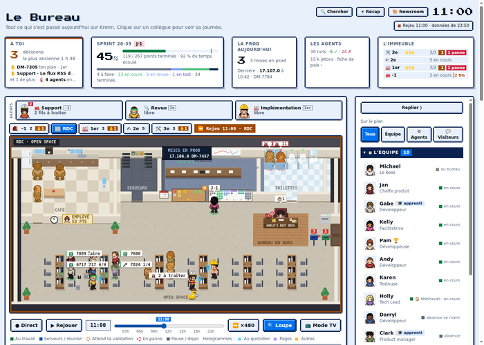

# Les habillages

Un habillage, c'est un **thème** (les couleurs de l'interface, `page/src/theme-<id>.css`) et un **plan** (le bureau dessiné, `layouts/<id>.json`) qui portent le même nom. Ils sont publics : chaque installation peut les choisir, et tout le monde peut en proposer un par une PR.

| Habillage | Thème | Plan |
|---|---|---|
| **Darkmode** (le défaut) | sombre : anthracite, crème, bleu | l'open space type, 40 × 20 cases |
| **Newsroom** | clair : blanc bleuté, bleu nuit, bleu vif ; mode TV « Newsroom nuit » | une rédaction de 40 × 20 cases : cafétéria, serveurs, réunion, plateau TV, bureau du boss, six îlots (trois pour l'équipe, trois pour les agents) |

`layouts/exemple-startup.json` est un plan sans thème du même nom : un bureau plus petit (30 × 16, sans plateau TV), là pour montrer qu'un plan se dessine avec n'importe quel thème.

## Choisir

- **Le thème** : bouton 🎨 de l'en-tête (le choix de chacun, gardé dans son navigateur), `ui.skin` de `bureau.config.json` (celui de l'installation), sinon celui que propose le plan (`skin`), sinon Darkmode ([Thème de la page](fonctionnalites/13-theme-page.md)).
- **Le plan** : l'installateur les propose tous (`python3 tools/install.py`), ou la clé `layout` de `bureau.config.json` (`"layouts/newsroom.json"`), ou le plan du pack d'équipe (`team.json`). Un plan se change aussi pour toute l'équipe depuis la page ([Changer de plan pour toute l'équipe](fonctionnalites/01-plan.md#changer-de-plan-pour-toute-léquipe)).
- **L'enseigne** : le panneau mural d'un plan affiche le nom de ton équipe, réglé dans son pack (`settings.json`, clé `enseigne`) ou dans ta config ([Le reste, facultatif](equipe.md#6-le-reste-facultatif)).

## La galerie

Chaque plan du dépôt dans chaque thème du dépôt, la démo à 11 h. Elle se refait toute seule : la CI la reprend avec les références visuelles (label « références visuelles » sur la PR), et `tools/shots.py --galerie` la refait en local.

| Plan \ thème | Darkmode | Newsroom |
|---|---|---|
| Darkmode |  |  |
| Newsroom |  |  |
| Exemple startup |  |  |

## Proposer un habillage

### Ajouter un thème

1. Copier `page/src/theme-darkmode.css` (sombre) ou `page/src/theme-newsroom.css` (clair) en `page/src/theme-<id>.css`, `<id>` en minuscules, sans espace ; première ligne `/* @nom: Nom affiché */`.
2. Remplacer partout `data-skin="darkmode"` par `data-skin="<id>"`, puis les couleurs. Un thème du dépôt définit toutes ses couleurs ; un bloc `body.tv` facultatif habille le mode TV.
3. Vérifier les contrastes : `python3 tools/theme.py check page/src/theme-<id>.css` (texte 4,5:1 au moins sur ses fonds, blanc sur ses aplats).

Le détail des variables : [Ajouter un thème](developpement.md#ajouter-un-thème).

### Ajouter un plan

1. Partir d'un plan du dépôt, ou d'un croquis : `python3 tools/plan.py from-image croquis.jpg` ([Plan du bureau](developpement.md#plan-du-bureau-layoutsjson)).
2. `id` et `name` : ceux de l'habillage ; `skin` : l'id du thème du même nom, s'il existe.
3. `zones` : les îlots de l'équipe et ceux des agents (`{"equipe": ["I1", "I2"], "agents": ["I3"]}`). Chacun s'y range tout seul ; un plan ne nomme personne.
4. Le panneau mural (`wall`, type `sign`) sans `text`, ou « LE BUREAU » : le nom vient de l'équipe qui l'installe (réglage `enseigne`).
5. Vérifier : `python3 tools/plan.py check layouts/<id>.json`, puis `python3 tools/plan.py seats layouts/<id>.json` et `.venv/bin/python tools/plan.py preview layouts/<id>.json`.

### Les règles

- **Ni marque ni vrai nom** : ni le nom d'une entreprise ou d'une équipe, ni celui d'une personne, ni un logo, dans le thème, le plan ou leurs commentaires. Le nom d'une équipe va dans son pack (`enseigne`), ses couleurs de marque aussi si elles sont protégées (un thème de pack, `themes/theme-<id>.css`, n'est proposé qu'à son équipe).
- **Des dessins dont on connaît la licence** : un plan n'utilise que les meubles et décors du catalogue (`furniture`, `wall`), dessinés par le Bureau ; un dessin nouveau vient avec sa licence et sa ligne dans [CREDITS.md](../CREDITS.md).
- **Les captures** : la galerie se refait avec `.venv/bin/python tools/shots.py --galerie` ; ajoute la ligne ou la colonne du nouveau plan ou du nouveau thème au tableau ci-dessus (un test vérifie qu'il n'en manque aucune). La page de fonctionnalité [Thème de la page](fonctionnalites/13-theme-page.md) cite les habillages.
- **Le label** : pose « références visuelles » sur la PR. La CI refait les références visuelles et la galerie sous Linux, et les pousse sur ta branche.
